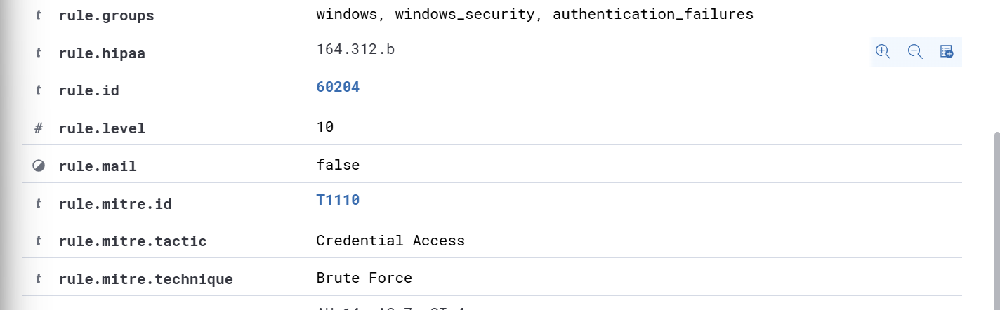
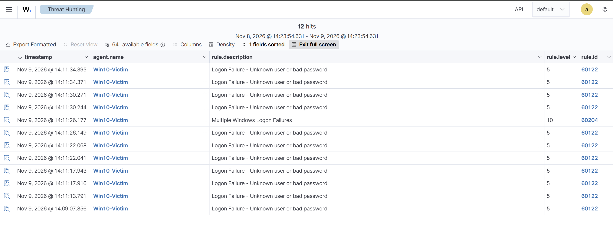

# Project 1: Windows Log Monitoring with Wazuh

## 1. Goal

Build a small SIEM lab and check that it can detect a simulated brute-force attempt on a Windows machine. I also wanted to see Sysmon events arriving in the SIEM and practise deciding whether an alert is real or a false positive.

## 2. Setup

| Machine | Role |
|---------|------|
| Ubuntu Server 24.04 VM (6 GB RAM, 2 CPUs, 50 GB disk) | Wazuh 4.14 server: indexer, manager, dashboard |
| Windows 10 VM (4 GB RAM) | Victim machine with Sysmon and the Wazuh agent |
| Kali Linux VM | Attacker machine (used in project 2) |

- All VMs run in VMware Workstation on a NAT network.
- Sysmon uses the SwiftOnSecurity configuration.
- The Wazuh agent on Windows was told to read the Sysmon log by adding this block to `ossec.conf`:

```xml
<localfile>
  <location>Microsoft-Windows-Sysmon/Operational</location>
  <log_format>eventchannel</log_format>
</localfile>
```

## 3. What I did

1. Installed the Wazuh server on Ubuntu with the all-in-one installer.
2. Installed Sysmon on the Windows VM.
3. Installed the Wazuh agent on Windows and confirmed it showed as **Active** in the dashboard.
4. Simulated failed logons on my own Windows VM using a fake account name and a wrong password.
5. Searched the Wazuh dashboard (Threat Hunting > Events) for `data.win.system.eventID: 4625`.
6. Searched for Sysmon events with `data.win.system.providerName: "Microsoft-Windows-Sysmon"`.

## 4. What I found

### Failed logons

- 11 alerts from rule **60122** ("Logon Failure - Unknown user or bad password"), level 5, Windows Event ID 4625.
- Then one alert from rule **60204** ("Multiple Windows Logon Failures"), level 10.
- Wazuh mapped the level 10 alert to **MITRE ATT&CK T1110 (Brute Force)**, tactic Credential Access.




### Sysmon events

- 192 Sysmon events reached Wazuh in the first 24 hours of the search window.
- Many were rule **92217** ("Executable dropped in Windows root folder", level 6, Sysmon Event ID 11).

## 5. Analyst conclusion

**Failed logons:** One failed logon is normal noise. Repeated failures in a short time are what an analyst investigates. The jump from level 5 to level 10 shows the correlation rule doing that work. In a real SOC, my next steps would be to check the source IP, the target account and whether any logon succeeded afterwards.

**Sysmon alert 92217 (false positive):** I opened one alert and checked the fields:

- Process: `C:\Windows\Microsoft.NET\Framework64\v4.0.30319\mscorsvw.exe` (the .NET Native Image Generator, a Microsoft service)
- File created: a `TaskScheduler.dll` inside the `NativeImages` folder under `C:\Windows\assembly`
- User: `NT AUTHORITY\SYSTEM`

The process path, folder and user all match normal .NET behaviour, so I classed it as a **benign false positive**. I did not check the file hash or the parent process, so I can't be 100% sure. If the same process name had appeared in a user folder, or a DLL had been dropped outside `NativeImages`, I would have treated it as suspicious. To reduce noise I would add an exception for this process and path rather than turn the rule off.

## What went wrong and how I fixed it

| Problem | Cause | Fix |
|---------|-------|-----|
| Wazuh install failed twice | Too little RAM (4 GB) | Raised the VM to 6 GB |
| Manager "start timeout" | Service took longer than the default limit to start | Added a systemd override with `TimeoutStartSec=300` |
| "No space left on device" | Ubuntu used only 24 GB of the disk | Extended the logical volume with `lvextend -r -l +100%FREE` |
| Dashboard login failed | I used an old password from a stale folder | Read the real password from `wazuh-install-files.tar` |
| Indexer would not start | A root-owned `/etc/wazuh-indexer/backup` folder left by a failed password-tool run | Moved the folder, then restarted the indexer (cluster status turned green) |
| Windows could not reach the server after resume | Stale network after VM resume | `ipconfig /release` then `ipconfig /renew` |

## What I learned

- Check disk, RAM and service logs first when a SIEM won't start.
- Read the real alert fields before deciding anything.
- Take snapshots before changing anything in the lab.

## Next

Project 2: simulate a brute-force attack from Kali against the Windows VM and write an incident summary from the Wazuh alerts.
